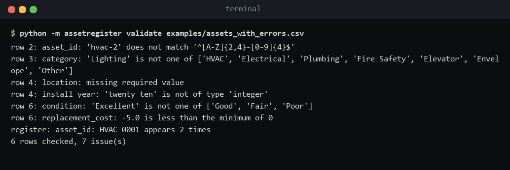

# asset-register-template

[](https://github.com/yassine2med/asset-register-template/actions/workflows/ci.yml)  

A facility asset register is only useful if every row follows the same rules: one unique ID per asset, a known category, a numeric install year and a real replacement cost. Spreadsheets drift from this over time. This repo ships a JSON Schema for a facility asset, sample registers, and a small command line validator that reports each bad row and field.



## What it is for

Asset registers kept in spreadsheets drift: duplicate IDs, misspelled categories, blank locations and text where a year should be. Facility coordinators, asset managers and project engineers handing over a building use this tool to check a register before it goes into a maintenance system or a capital plan. They get a list of every bad row and field, and a schema other tools can reuse.

## Install

```
git clone https://github.com/yassine2med/asset-register-template
cd asset-register-template && pip install -r requirements.txt
```

## How to use

| I want to | Command |
|---|---|
| Check a register CSV and list every bad row and field | `PYTHONPATH=src python -m assetregister validate examples/assets_with_errors.csv` |
| Check a clean register (prints "6 rows checked, 0 issue(s)", exit code 0) | `PYTHONPATH=src python -m assetregister validate examples/assets_valid.csv` |
| Print the JSON Schema so other tools can reuse it | `PYTHONPATH=src python -m assetregister schema` |
| Show help | `PYTHONPATH=src python -m assetregister --help` |

Exit codes for `validate`: 0 when the register is clean, 1 when issues exist, 2 when the file is missing.

Example:

```
PYTHONPATH=src python -m assetregister validate examples/assets_with_errors.csv
```

Output:

```
row 2: asset_id: 'hvac-2' does not match '^[A-Z]{2,4}-[0-9]{4}$'
row 3: category: 'Lighting' is not one of ['HVAC', 'Electrical', 'Plumbing', 'Fire Safety', 'Elevator', 'Envelope', 'Other']
row 4: location: missing required value
row 4: install_year: 'twenty ten' is not of type 'integer'
row 6: condition: 'Excellent' is not one of ['Good', 'Fair', 'Poor']
row 6: replacement_cost: -5.0 is less than the minimum of 0
register: asset_id: HVAC-0001 appears 2 times
6 rows checked, 7 issue(s)
```

Run the tests with `python -m pytest -q`.

## How it works

1. Each CSV row is read as strings and converted: `install_year` and `expected_life_years` to integers, `replacement_cost` to a number, empty cells dropped.
2. A value that cannot be converted stays a string, so the schema reports it as a type error instead of crashing.
3. Every row is checked against `src/assetregister/asset.schema.json` (JSON Schema draft 2020-12) using the `jsonschema` library.
4. A missing required column value is reported with the field name.
5. A register-level check flags any asset ID that appears more than once.

## Limits

- CSV input only. No Excel files, no database.
- The category and condition lists are fixed in the schema; edit the JSON file to change them.
- It checks format, not truth: it cannot know that a chiller was really installed in 2008.

## License

MIT. Yassine Emhamed, 2026.
